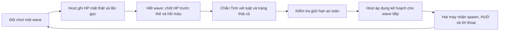

# Chằn Tinh — chủ dungeon và AI đạo diễn

Quyết định 11/10/2026: **AI đạo diễn chính là Chằn Tinh**. Hắn điều khiển quân trong wave 1–9, rồi trực tiếp bước vào trận ở wave 10. Người chơi đang vượt qua thử thách do cùng một đối thủ tổ chức, trước khi đối đầu với hắn.

Tài liệu này giải thích mã hiện hành cho người chơi và nhóm báo cáo. Thiết kế tổng thể: [GDD.md](GDD.md); bằng chứng thuật toán trước thay đổi vai trò: [DIRECTOR_TESTS.md](DIRECTOR_TESTS.md). Lời thoại/ý đồ là cách trình bày quyết định thật, không là một thuật toán học máy mới.

## 1. Chằn Tinh làm hai việc gì?

| Giai đoạn | Việc Chằn Tinh làm | Mã điều khiển |
|---|---|---|
| Wave 1–9 | Tổ chức thử thách: chọn nhịp sinh, hướng quân vào và thành phần quái | `Director/AIDirector.cs` + `Core/RunDirector.cs` |
| Wave 10 | Xuất hiện dưới dạng boss, dùng đòn lao/phun đạn, rồi triệu hồi/quét đuôi | `Enemies/EnemyBoss.cs` + `BossNetwork.cs` |

Đây là hai tầng hành vi của **cùng Chằn Tinh**. Tầng điều binh đánh giá cả đội giữa các wave. Tầng chiến đấu của boss chọn đòn trong trận bằng FSM riêng. Wave 10 vẫn giữ thông số đã thiết kế; tầng điều binh không tự đổi HP/sát thương boss theo tình trạng đội.

Hắn là kẻ săn đuổi muốn cuộc thử thách tiếp diễn. Khi đội gần kiệt sức, hắn **giãn quân**, tạo khoảng thở; khi đội khỏe, hắn **đổi thế vây**. Cách xây dựng tính cách này giúp trình bày cơ chế điều tiết độ khó đang có mà không biến hắn thành đối thủ gian lận hoặc phải làm AI phức tạp hơn.

## 2. Một lượt quyết định diễn ra thế nào?

1. Trong wave, host ghi nhận sát thương **thực sự làm mất HP**, sau khi đã xét i-frame/miễn sát thương. Đòn không trừ HP không được tính.
2. Khi wave kết thúc, host chụp dữ liệu cuối wave **trước** chọn thẻ và hồi máu. Hồi máu trong lúc nghỉ không làm mất dấu áp lực vừa trải qua.
3. Trước wave tiếp theo, Chằn Tinh đọc dữ liệu đó và nhớ mình có đang ở trạng thái Giãn binh hay không.
4. Hắn chọn một trong ba trạng thái, dựng kế hoạch từ bảng wave gốc và kiểm tra kế hoạch an toàn.
5. Host thực thi kế hoạch. HUD thể hiện ý đồ và lời thoại; F3/CSV lưu lý do và số liệu thật.

Chằn Tinh quyết **một lần trước wave 2–9**, không thay kế hoạch mỗi frame hoặc đổi đột ngột giữa một wave. Wave 1 dùng kế hoạch mở đầu; wave 10 dùng kế hoạch boss. Chọn thẻ và thời lượng wave giữ nguyên.

## 3. Hắn quan sát những gì?

| Dữ liệu | Cách tính | Ví dụ |
|---|---|---|
| HP thấp nhất (`healthMin`) | Lấy tỷ lệ HP cuối wave/max HP cuối wave nhỏ nhất trong các người còn kết nối | Warrior 10/10, Archer 1/6 → đội có HP thấp nhất **16,7%** |
| Tổn thất cao nhất (`damageRatioMaxRaw`) | Với mỗi người, cộng HP đã mất thật trong wave, chia max HP đầu wave; lấy tỷ lệ lớn nhất | Archer mất 5 HP trên max 6 → **83,3%** |
| Số lần gục (`downs`) | Tổng số lần người chơi chuyển sang gục trong wave | Một người gục hai lần sau khi được cứu → **2**, không chỉ 1 người chết |

HP thấp nhất và tổn thất cao nhất có thể đến từ **hai người khác nhau**. Không lấy trung bình, vì một Warrior đầy máu có thể che mất tình trạng của Archer sắp gục.

HP mất được cộng dồn: mất 4, hồi 4 rồi mất 4 tiếp vẫn là **8 HP tổn thất**, dù HP cuối wave có thể còn cao. Tổn thất thô có thể vượt 100% sau nhiều lần hồi sinh/hồi máu; CSV giữ số thật, luật quyết định dùng bản kẹp về 0–100%.

## 4. Ba ý đồ điều binh

| Ý đồ người chơi thấy | Trạng thái trong mã | Khi nào chọn? | Hắn thay đổi gì? |
|---|---|---|---|
| **Giãn binh** | `Relief` | HP thấp nhất ≤30%, **hoặc** tổn thất cao nhất ≥35%, **hoặc** có ít nhất một lần gục | Khoảng cách thời gian giữa các lần sinh ×1,25; số quái mỗi lần sinh = `max(1, floor(số gốc ×0,75))` |
| **Đổi thế vây** | `Variety` | HP thấp nhất ≥70%, tổn thất cao nhất ≤10%, không ai gục; đã đủ điều kiện thoát Giãn binh nếu trước đó đang ở trạng thái này | Xoay vị trí sinh trên chu vi sân và có thể thay một quái trong chu kỳ bằng loại đã giới thiệu, chi phí suất không cao hơn |
| **Điều binh** | `Balanced` | Các trường hợp còn lại | Giữ kế hoạch gốc của wave |

Ví dụ lời thoại tương ứng:

- Giãn binh: “Chậm bước! Ta muốn cuộc săn này kéo dài.”
- Đổi thế vây: “Đổi hướng bao vây! Đừng để chúng quen đường tiến quân.”
- Điều binh: “Giữ đội hình! Để xem các ngươi trụ được bao lâu.”

Lời thoại hiện là nội dung có sẵn trong ScriptableObject `DungeonMaster.asset`. Không gọi ChatGPT/LLM, không sinh lời nói tự do; cùng kết quả host sẽ cho cùng ý đồ/lời thoại trên hai máy. Quá trình chọn trạng thái là luật có ngưỡng, không huấn luyện từ dữ liệu người chơi.

### Vì sao Giãn binh không bật/tắt liên tục?

Sau khi đã Giãn binh, hắn chỉ thoát khi **cả ba** điều kiện cùng đạt: HP thấp nhất ≥50%, tổn thất cao nhất ≤20% và không gục trong wave vừa qua. Đây là khoảng trễ chuyển trạng thái, thường gọi là *hysteresis*.

Ví dụ: đội xuống 25% HP → Giãn binh. Wave sau còn 40% HP, tổn thất 15%, không gục → vẫn Giãn binh. Wave tiếp đạt 60% HP/15% tổn thất → trở về Điều binh. Nếu đạt 80% HP/5% tổn thất → Đổi thế vây.

### Đổi thế vây có làm đội mạnh bị phạt không?

Kế hoạch Variety giữ nguyên thời lượng, nhịp sinh, burst và không tăng HP/sát thương/tốc độ quái. Hắn đổi vị trí quân vào bằng 0,10–0,30 **phần chu vi sân** theo một trong hai chiều, không phải 10–30 độ. Hắn có thể đổi một quái trong chu kỳ thành loại đã xuất hiện ở các wave đến thời điểm đó, với chi phí suất nhỏ hơn hoặc bằng. Nếu không có loại thay thế phù hợp thì chỉ đổi hướng.

Sự đa dạng có thể thay đổi cảm giác khó, nhưng chưa có playtest chứng minh cân bằng cuối. Không tuyên bố mọi cách phối quân có độ khó bằng nhau.

## 5. Ví dụ co-op cụ thể

Cuối wave 1: Warrior còn 10/10 HP, Archer còn 1/6 và vừa mất 5 HP; không ai gục.

1. HP thấp nhất = `min(100%, 16,7%) = 16,7%`.
2. Tổn thất cao nhất = `max(0%, 83,3%) = 83,3%`.
3. Cả HP thấp và tổn thất cao đều đủ kích hoạt Giãn binh.
4. Nếu bảng gốc wave 2 có nhịp 1,4 giây và burst 1, kế hoạch thực thi là **1,75 giây**, burst vẫn **1** do trần dưới.
5. Hồi Archer lên đầy máu trong lượt chọn thẻ không làm snapshot vừa chốt biến thành 100%. Chằn Tinh vẫn giãn quân ở wave 2.
6. Cả hai máy thấy **CHẰN TINH · GIÃN BINH**, cùng lời thoại; host sinh quân theo nhịp 1,75 giây. F3/CSV cho thấy lý do 16,7% HP/83,3% tổn thất.

Burst 4 là ví dụ công thức riêng: `floor(4 ×0,75) = 3`. Không gán burst 4 cho wave 2 đang chạy nếu asset của wave đó chỉ có burst 1.

## 6. Những giới hạn giữ trận công bằng

- Tổng suất quái sống tối đa **40**, tính cả quái con của Quỷ Nhỏ.
- Điểm sinh cách mọi người còn sống ít nhất **3 đơn vị**; host kiểm tra vị trí thật.
- Không đưa loại quái chưa được giới thiệu vào kế hoạch Variety; không tăng ngân sách suất gốc.
- Không tăng sức mạnh/chỉ số người chơi hoặc quái để diễn lời thoại; không sửa dữ liệu asset trong ván.
- Giữ thời lượng 9 wave thường và kế hoạch boss cuối. AI không sinh liên tục vô hạn hoặc kéo dài wave để ép đội mất máu.
- Người vào muộn thiếu một wave lịch sử làm kế hoạch kế tiếp dùng bảng gốc; đủ một wave mới sẽ có ngữ cảnh đầy đủ. Người rời không còn kéo thấp HP đội, nhưng tổn thất/lần gục đã xảy ra vẫn là lịch sử của wave.
- Thiếu dữ liệu/luật hoặc kế hoạch mới lỗi → dùng baseline hợp lệ, ghi lý do fallback. Baseline cũng lỗi → dừng ván an toàn.

## 7. Khi hắn bước vào wave 10

HUD ra lời: “Đủ rồi. Lần này ta sẽ tự tay kết liễu các ngươi!”; thanh máu boss hiện Chằn Tinh. Đây là đối thủ đã điều binh ở các wave trước.

FSM boss hiện hành:

- HP ban đầu **800** khi một người, **1600** khi hai người, chốt lúc boss xuất hiện.
- Pha 1: nghỉ/báo trước → **lao** và **phun đạn hình quạt** xen kẽ → nghỉ giữa các đòn. Hướng tấn công nhắm người sống gần nhất lúc chọn đòn.
- Đạt ngưỡng **50% HP** thì chuyển pha. Pha 2: **triệu hồi Ma Da** khi đến lượt hồi triệu hồi, còn lại **quét đuôi**; không tự học cách né của người chơi.
- Cấu hình hiện tại: báo trước 0,9s, hồi giữa đòn 1,2s; lượt triệu hồi cách nhau 8s, tối đa 4 Ma Da mỗi lượt trong giới hạn suất.
- Host quyết đòn/sát thương/HP; client biểu diễn từ sự kiện. Trống Đồng có thể ngắt đòn theo cơ chế đã có.

Tên diễn đạt “Chằn Tinh điều binh rồi ra trận” là thay đổi vai trò và cách trình bày. Chưa thêm cơ chế tự đổi đòn boss theo ba trạng thái của đạo diễn. Độ khó boss/nhịp tự nhiên vẫn cần T-50/T-51.

## 8. Chơi đơn và multiplayer khác nhau ở đâu?

**Cùng một thuật toán**, chạy trên host. Chơi đơn cũng là Mirror host với một client; không có nhánh AI riêng cho solo. Co-op tổng hợp dữ liệu của cả hai người và ưu tiên người yếu nhất.

Host quyết chế độ trước kết nối, thu dữ liệu, chọn kế hoạch và thực thi sinh quái. Client không tự chọn Relief/Variety hoặc tự sinh kế hoạch thích ứng thứ hai; nó nhận sự kiện spawn và các trường mode/state/source/context để hiện HUD. Lời thoại là biểu diễn cục bộ từ kết quả chung, không gửi chuỗi thoại riêng mỗi frame, không thêm NetworkIdentity cho đạn/VFX.

Restart trong phòng giữ chế độ Cố định/Thích ứng nhưng reset ngữ cảnh và trạng thái cũ; phiên mới sau ngắt kết nối có thể chọn chế độ khác. Kết nối Internet hai máy vẫn phải nghiệm thu riêng T-40; lời thoại mới không thay bằng chứng online.

## 9. Cách xem và giải thích khi báo cáo

1. Mở Arena, Play, chọn **Thích ứng**, tạo host; người thứ hai vào cùng host.
2. Quan sát lời của Chằn Tinh mỗi wave: wave đầu Thăm dò, các wave giữa Điều binh/Giãn binh/Đổi thế vây, wave cuối Đối đầu.
3. Nhấn **F3**: đọc HP/tổn thất/gục của wave trước, nguồn quyết định, lý do thật và fallback. Dữ liệu này giải thích vì sao hắn ra lệnh như vậy.
4. Đối chiếu `directors.csv`: `adaptive_rules` là quyết định luật; `fixed_table` là bảng gốc; `fixed_fallback` là dự phòng. Không coi lời thoại là bằng chứng thuật toán đã thích ứng nếu source là Fixed/fallback.
5. Thử **Cố định** trong một phiên mới để so sánh: cùng Chằn Tinh và cùng boss, nhưng wave giữa giữ kế hoạch bảng gốc, không điều tiết theo đội.

Câu trình bày ngắn: **“Chằn Tinh là đối thủ xuyên suốt ván. Trước wave 2–9, host dùng luật và FSM để tổng hợp tình trạng đội, rồi cho hắn giữ quân, giãn quân hoặc đổi thế vây trong giới hạn an toàn. Đến wave 10 hắn xuất hiện và chiến đấu bằng FSM boss hai pha. Hai người nhận chung kết quả từ host; F3 và CSV giúp kiểm chứng quyết định.”**

## 10. Chỉnh nội dung ở đâu?

| Muốn chỉnh | Nơi chỉnh |
|---|---|
| Ngưỡng HP/tổn thất, hệ số Giãn binh, khoảng xoay hướng | `Assets/_LAC/Data/Director/Resources/Director/DirectorRules.asset` |
| Tên Chằn Tinh, ý đồ, lời thoại, mô tả mode | `Assets/_LAC/Data/Director/Resources/Director/DungeonMaster.asset` |
| Nhịp/thành phần/thời lượng baseline từng wave | `Assets/_LAC/Data/Waves/WaveTable_CoDinh.asset` |
| Đòn, nhịp báo trước, hồi đòn và ngưỡng chuyển pha boss | `Assets/_LAC/Data/Enemies/ChanTinhRules.asset` |
| HP/chỉ số quái boss | `Assets/_LAC/Data/Enemies/ChanTinh.asset` |

Chỉnh asset khi đã thoát Play. Thay ngưỡng gameplay cần chạy lại kiểm thử và chơi thật; đổi lời thoại không tự thay thuật toán. Bằng chứng T-46C được ghi sau khi chạy kiểm chứng, không sử dụng ảnh HUD cũ để chứng minh giao diện Chằn Tinh mới.

## 11. Kiểm chứng T-46C ngày 11/10/2026

Đã kiểm tra MCP đúng `LAC-main`, Unity 6000.5.6f1, Arena. Mọi lần sửa `.cs` đều ở Edit Mode; không sửa scene/prefab hoặc thuật toán gameplay trong hạng mục này.

| Kiểm tra | Kết quả |
|---|---|
| Luật/ngữ cảnh sau thêm nội dung Chằn Tinh | 863 assertions Edit Mode đạt; ngưỡng/hysteresis/an toàn giữ nguyên |
| Tích hợp hai Editor/100ms | **76 assertions PASS**, đủ 10 wave, sát thương/heal/ngữ cảnh/FSM, Applied spawn, CSV, boss, Victory/Defeat và Restart. [Kết quả](validation/T46C/coop.txt), [CSV quyết định](validation/T46C/coop-csv/directors.csv) |
| Host/client cùng ý đồ | Client hiện đúng Giãn binh, Đổi thế vây, Giữ kế hoạch khi `missing_rules`, Đối đầu khi wave 10; source/context/title khớp host, `telemetry=False`. [Client probe](validation/T46C/client.txt) |
| Boss vật lý và vai trò | Wave 10 có boss thật 1600/1600 HP khi hai người, HUD “CHẰN TINH · ĐỐI ĐẦU” cùng thanh boss. [Ảnh đã xem](validation/T46C/boss.png) |
| Fixed và đọc chữ | Wave 2 có HP 20%/tổn thất 80% vẫn giữ nguồn `fixed_table`, interval 1,4s; lời thoại Kế hoạch cố định, F3 nói đúng lý do. Cả bốn text không overflow. [Kết quả](validation/T46C/fixed.txt), [ảnh](validation/T46C/fixed.png) |
| Các ảnh còn lại đã xem | [Mở đầu](validation/T46C/opening.png), [Giãn binh/F3](validation/T46C/relief.png), [Đổi thế vây/F3](validation/T46C/variety.png), [fallback/F3](validation/T46C/fallback.png), [màn chọn](validation/T46C/selection.png). HUD/đòn/thanh máu vẫn rõ |
| Console Editor chính | **0 lỗi, 0 cảnh báo**, compilationFailed false, đã dừng host/client và thoát Play sau kiểm tra. [Kết quả](validation/T46C/console.txt) |

Ảnh kiểm tra dùng fixture: HP/miễn sát thương và deadline được điều khiển, có lúc tắt WaveManager để giữ trạng thái chụp. Vòng tích hợp 76 assertions chạy riêng với WaveManager bật. Các thao tác này không là chơi thật để chứng nhận cân bằng/thời lượng.

Client là bản sao TEMP riêng, dùng font/shader/settings đã bàn giao trong `_LAC`, bật `--burst-disable-compilation` cho fixture. Bản sao có lỗi startup PackageCache/SpriteAtlasIssueReport và Search indexing, cùng lỗi kết nối dịch vụ Unity; [trích log môi trường](validation/T46C/client-environment.txt). Không có lỗi CS/NullReference của HUD mới được tìm thấy trong log này; không tuyên bố toàn bộ Console client sạch. Chỉ tiến trình client do kiểm thử này khởi động đã được dừng; không đổi chính sách Windows hoặc package dự án chính.

Đây là kiểm chứng vai trò/lời thoại/HUD và hồi quy tích hợp. Chưa đo lại hiệu năng sau thay đổi HUD, chưa nghiệm thu Internet/build Windows, chưa thêm AI học cách chọn đòn boss từ dữ liệu đội. Không suy rộng kết quả sang các hạng mục đó.
