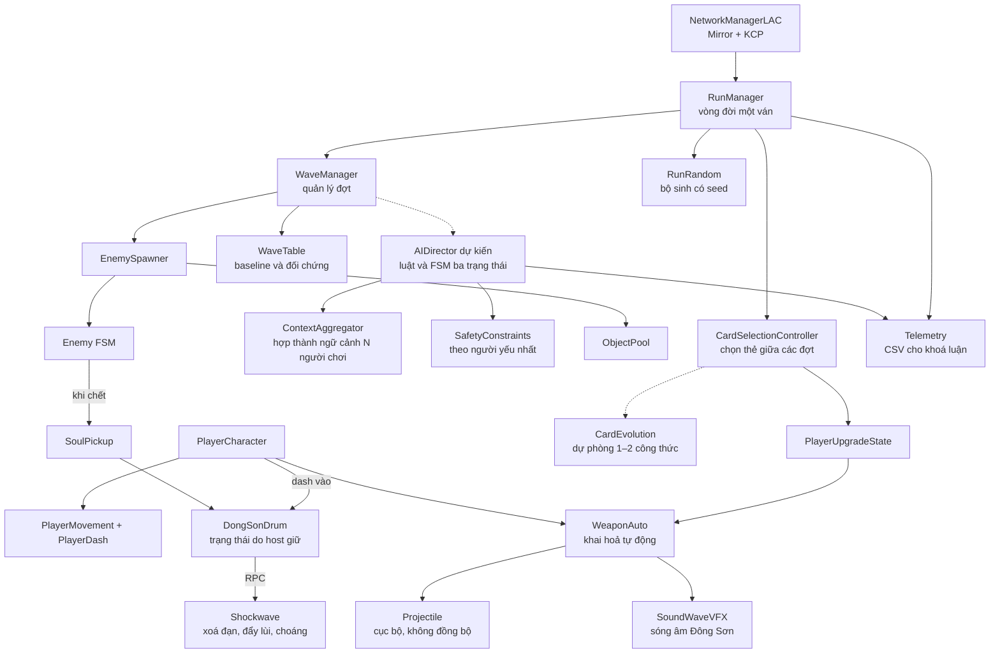

# Kiến trúc hệ thống — LẠC

Tài liệu tham chiếu kỹ thuật. Xác định các module tồn tại trong hệ thống, trách nhiệm của từng module và quan hệ gọi giữa chúng.

Đọc [CLAUDE.md](../CLAUDE.md) và [THESIS_SCOPE.md](THESIS_SCOPE.md) trước tài liệu này. Cập nhật 11/10/2026: chỉ đồ án, không Steam/thương mại; AI luật/FSM thay LinUCB, không bắt buộc tiến hoá thẻ.

**Phân biệt thiết kế và triển khai:** các tên `AIDirector`, `ContextAggregator`, `SafetyConstraints` ở sơ đồ/mục 2.7 là thành phần dự kiến T-45/T-45B, chưa có mã. Bảng cố định/telemetry đã có. Một số tên lớp trong mô tả là tên vai trò khái niệm; các lớp thẻ thật là `CardDeck`, `CardSelectionController`, `PlayerUpgradeState`. Tiến độ lấy TASKS, không lấy sự xuất hiện trong sơ đồ.

---

## 1. Sơ đồ tổng thể



---

## 2. Đặc tả module

### 2.1 Core — hạ tầng nền tảng

| Lớp | Trách nhiệm | Ghi chú |
|---|---|---|
| `RunManager` | Vòng đời một ván: khởi tạo, điều phối 10 đợt, xác định điều kiện thắng thua | Chỉ host điều khiển tiến trình |
| `WaveManager` | Dựng lịch, lặp sinh trong wave tính giờ, kết thúc theo deadline; boss kết thúc khi sạch | Host quyết timed spawn; client biểu diễn, boss dựng lịch từ seed |
| `RunRandom` | Các kênh `RandomStream` Xorshift128 theo seed ván. **Nguồn ngẫu nhiên duy nhất trong gameplay** | Seed được đồng bộ một lần khi khởi tạo ván |
| `ObjectPool<T>` | Pool dùng chung cho đạn, quái, hiệu ứng, số sát thương | Bắt buộc thay thế cho `Instantiate` trong gameplay |
| `GameEvents` | Sự kiện `EnemyDied`, `EnemyTouchedPlayer`, `PlayerDamaged`, `EnemyDamaged` | Wave/card còn dùng sự kiện ở RunManager và hệ thống thẻ |

**Trình tự khái niệm một đợt (Adaptive là phần dự kiến):**

```
RunManager bắt đầu wave n
  → WaveManager lấy WaveSpec (hiện WaveTable; tương lai có AIDirector)
  → Host thi hành lượt sinh → EnemySpawner phát sự kiện
  → Wave 1–9: hết deadline NetworkTime → chọn thẻ
  → Boss wave 10: hạ boss, dọn quái con → Victory (không chọn thẻ)
  → RunManager báo WaveCleared cho wave thường
  → CardSelectionController mở ba lựa chọn
  → Chờ toàn bộ người chơi hoàn tất lựa chọn
  → StartWave(n + 1)
```

### 2.2 Player

| Lớp | Trách nhiệm |
|---|---|
| `PlayerCharacter` | Giữ lớp đã chọn và tham chiếu `CharacterData` |
| `PlayerMovement` | Di chuyển 8 hướng; client dự đoán cục bộ nhân vật của mình |
| `PlayerDash` | Dash, i-frame, thời gian hồi. Đồng thời là tín hiệu kích hoạt Trống Đồng |
| `PlayerHealth` | Quản lý máu. **Chỉ host được phép thay đổi.** Client nhận qua `SyncVar` và RPC biểu diễn |
| `PlayerUpgradeState` | Chỉ số nâng cấp của ván, không sửa `CharacterData` |

`CharacterData` (ScriptableObject) chứa: máu gốc, tốc độ, prefab vũ khí, sprite, đặc tính riêng.

### 2.3 Combat

| Lớp | Trách nhiệm |
|---|---|
| `WeaponAuto` | Đếm chu kỳ, chọn mục tiêu, khai hoả; đọc dữ liệu lớp và `PlayerUpgradeState` |
| `Projectile` | Quỹ đạo, va chạm, xuyên thấu và nảy. **Không mang `NetworkIdentity`** |
| `DamageSystem` | Điểm vào duy nhất cho mọi sát thương. Chỉ thực thi trên host |

> Sát thương đi qua `DamageSystem.ApplyToPlayer`/`ApplyToEnemy`, sau đó chuyển cho PlayerHealth/EnemySpawner do host quản lý. Client không tự quyết HP. Không dùng tên API `Apply()` của thiết kế cũ khi tìm mã.

### 2.4 Enemies

Máy trạng thái ba trạng thái: `Spawning` → `Chasing` → `Attacking`. `EnemyData` (ScriptableObject) chứa máu, tốc độ, sát thương, hành vi và sprite.

Wave tính giờ: host quyết lượt sinh rồi phát sự kiện; client mô phỏng biểu diễn. Boss giữ lịch từ seed. Host gửi snapshot roster/vị trí 2 lần/giây để hiệu chỉnh và vào muộn; sự kiện chết qua RPC. Không gắn NetworkIdentity lên mỗi quái/đạn.

T-34: `EnemyBehaviours` bổ sung giữ khoảng cách/bắn chậm cho Ma Trơi và báo trước/lao thẳng cho Ma Da. Bù Nhìn dùng truy đuổi với chỉ số riêng. Quỷ Nhỏ tách thành hai Cô Hồn từ sự kiện chết của host. `EnemyCatalogData` ánh xạ định danh loại quái trong gói mạng; `EnemyProjectile` dùng pool và chỉ host kiểm tra sát thương, có `EnemyProjectileClearable` để Trống Đồng thu hồi.

T-35: ID theo đợt (`wave × 1000 + thứ tự`); quái con dùng ID âm từ ID cha, không tiêu bộ đếm lịch sinh. Snapshot reliable chứa toàn bộ ID, loại, vị trí, vận tốc, mốc thời gian, số thứ tự và mã ván/đợt. Client bù độ trễ tối đa một chu kỳ snapshot rồi triệt sai lệch dần trong các bước vật lý; lệch trên 4 đơn vị được đưa về ngay. Roster khôi phục quái chưa sinh ở client, loại quái đã chết và chặn lịch sinh trễ làm sống lại quái. Gói khác ván/đợt hoặc cũ bị bỏ qua. Chi tiết và cách kiểm thử: [ENEMY_TESTS.md](ENEMY_TESTS.md).

### 2.5 Cards

| Lớp | Trách nhiệm |
|---|---|
| `CardDeck` | 12 thẻ nền, lọc theo kiểu vũ khí, bốc 3 thẻ bằng `RunRandom` |
| `PlayerUpgradeState` | Áp hiệu ứng lên chỉ số của ván |
| `CardEvolution` (dự phòng, chưa có) | Tối đa 1–2 công thức nếu còn thời gian; không là điều kiện bàn giao |
| `CardSelectionView` / controller / network | Giao diện, giới hạn 10 giây, 2 lượt đổi và thẩm định host |

Trong co-op, mỗi người chơi chọn thẻ độc lập nhưng đợt kế tiếp chỉ khởi động khi toàn bộ người chơi hoàn tất. Hệ thống đồng bộ định danh thẻ; mỗi máy tự áp dụng hiệu ứng.

### 2.6 Drum — Trống Đồng

| Lớp | Trách nhiệm |
|---|---|
| `DongSonDrum` | Biểu diễn cố định tại tâm đấu trường, nhịp sáng khi sẵn sàng, phát sóng từ pool |
| `DrumNetwork` (partial `RunManager`) | Giữ năng lượng, hồi chiêu và cờ sẵn sàng dưới dạng SyncVar; host kiểm tra dash, tiêu năng lượng, áp đẩy lùi/choáng và phát RPC |
| `DrumShockwave` | Kiểm tra đoạn lướt chạm vùng trống, tránh bỏ sót khi lướt nhanh |
| `EnemyProjectileClearable` | Đăng ký đạn địch cục bộ và callback thu hồi; xung kích chỉ xoá phe địch |
| `DrumHud` | Vòng năng lượng và vòng hồi chiêu dùng chung, chỉ đọc trạng thái host |
| `SoulPickup` | Hồn rơi ra khi quái chết, tự hút về người chơi, nạp năng lượng cho trống |

**Luồng kích hoạt:**

```
Client dash chạm trống
  → PlayerDash.CmdTryActivateDrum()
  → Host kiểm tra cú lướt, năng lượng và thời gian hồi
  → Nếu hợp lệ: host thi hành hiệu ứng, phát RpcPlayShockwave() cho phần biểu diễn
```

Client không tự xác định trạng thái sẵn sàng của trống; client chỉ hiển thị giá trị `SyncVar` nhận từ host.

T-36–38 dùng NetworkIdentity sẵn có của RunManager thay vì tạo thêm đối tượng mạng cho trống. Quy tắc 20 Hồn / 20 giây / choáng 1 giây đặt trong `DrumRules.asset`; chi tiết và cách kiểm tra tại [DRUM_TESTS.md](DRUM_TESTS.md).

### 2.7 Director — AI đạo diễn dự kiến

Thiết kế T-45/T-45B/T-46: AI **dựa trên luật + FSM ba trạng thái**, một thuật toán trên host cho đội một/hai người. Không LinUCB, learning, reward hay fairness optimization. Giữ bảng cố định làm baseline/đối chứng/fallback. Toàn bộ luật/ngưỡng tại [THESIS_SCOPE.md mục 4](THESIS_SCOPE.md#4-đạo-diễn-ai-dễ-giải-thích).

| Thành phần dự kiến | Trách nhiệm |
|---|---|
| `AIDirector` | Chọn Relief/Balanced/Variety và dựng WaveSpec từ baseline |
| `ContextAggregator` | HP ratio thấp nhất, tổn thất thực/max HP cao nhất, số lần gục; xử lý vào/rời |
| `DirectorRulesData` | Ngưỡng và hệ số trong ScriptableObject, không hard-code |
| `SafetyConstraints` | Giữ Duration/trần 40/khoảng cách an toàn, quái đã giới thiệu; fallback |
| HUD/CSV | Mode, trạng thái, lý do, đầu vào và kết quả áp dụng; client chỉ nhận biểu diễn |

**Đã có:** `WaveSpec`, `WaveTable`, spawn an toàn T-44D, `TelemetrySession`/`TelemetryCsv`/`RunTelemetry`. **Chưa có:** đạo diễn, ngữ cảnh AI, luật/HUD/CSV quyết định. T-45 phải nối nguồn đặc tả trong WaveManager và metadata nguồn trong telemetry; không mặc định chỉ thêm lớp mới là đã hoạt động.

Luồng dự kiến:

```text
Host kết thúc wave thường → chốt snapshot trước hồi/nâng cấp → lưu ngữ cảnh
→ chọn thẻ → trước wave 2–9: lấy baseline → chọn trạng thái → kẹp an toàn
→ WaveSpec → host sinh quái → RPC spawn + trạng thái HUD → client biểu diễn
→ ghi quyết định/đặc tả/kết quả CSV
```

Wave 1/boss wave 10 giữ gốc. Fixed/Adaptive chọn trước ván, không đổi giữa ván. Ngẫu nhiên nếu cần dùng `RunRandom.Director`; client không rút số/chạy chính sách lần nữa. Thiếu dữ liệu/đặc tả lỗi dùng baseline hợp lệ. Reset ván xoá trạng thái AI, không sửa asset hoặc giữ lợi thế.

Relief ưu tiên người yếu nhất/lần gục, giãn nhịp và giảm burst. Balanced dùng baseline. Variety chỉ đổi hướng/thành phần trong ngân sách khi cả đội ổn; không tăng HP/sát thương/quy mô để ép mất máu. Có ngưỡng thoát Relief khác ngưỡng vào để tránh nhấp trạng thái.

Không dùng `clearTime`: wave có Duration cố định. Tổn thất dùng sự kiện damage thật, không HP đầu trừ HP cuối; hồi máu/hồi sinh không xoá tổn thất đã ghi. Tổng hợp đội dùng cùng kiểu ngữ cảnh với một/hai người, không nhánh solo riêng.

Đánh giá: kiểm thử luật có kiểm soát, chơi thật ba lớp/10 wave, so sánh nhỏ Fixed/Adaptive và online hai mạng. Không yêu cầu mặc định 15/15; không tuyên bố hội tụ thuật toán hoặc cải thiện trải nghiệm trước khi đo.

### 2.8 Net

Xem [CLAUDE.md](../CLAUDE.md) mục 3.2 để biết bảng đồng bộ đầy đủ. Lớp mạng hiện có: `NetworkManagerLAC`; lobby/menu gọn T-30/T-60/T-62 còn cần làm. T-40 nghiệm thu Internet qua KCP, không `SteamLobby`/Steamworks. T-42 xử lý mất kết nối, không host migration.

### 2.9 VFX

| Lớp | Trách nhiệm |
|---|---|
| `SoundWaveVFX` | Vòng tròn đồng tâm lan toả mang hoa văn Đông Sơn, chế độ additive |
| `HitFeedback` | Hit-stop, nháy trắng, đẩy lùi, số sát thương |
| `CameraShake` | Rung màn hình theo cường độ va chạm |

**Ràng buộc đọc hiểu thị giác:** hiệu ứng của người chơi dùng alpha thấp, chế độ additive, sorting layer thấp. Đòn tấn công của địch vẽ đặc, dùng màu dành riêng, sorting layer cao nhất. Thứ tự này không được đảo ngược trong bất kỳ trường hợp nào.

---

## 3. Dữ liệu cấu hình

Toàn bộ thông số nằm tại `Assets/_LAC/Data/` dưới dạng ScriptableObject. Không hard-code trong C#.

```
Data/
├── Characters/   Warrior.asset · Archer.asset · Lancer.asset
├── Cards/        12 thẻ nền; tiến hoá dự phòng chưa triển khai
├── Enemies/      CoHon · MaTroi · BuNhin · MaDa · QuyNho · ChanTinh
└── Waves/        WaveTable_CoDinh.asset — baseline, co-op và đối chứng
```

Cách tổ chức này cho phép điều chỉnh cân bằng qua Inspector mà không chạm vào mã nguồn, đồng thời tránh xung đột với thành viên đang sửa code.

---

## 4. Scene

| Scene | Nội dung |
|---|---|
| `Boot` (dự kiến) | Khởi tạo hệ thống và hiển thị prefab menu |
| Menu/prefab trong `Boot` (dự kiến) | Menu, chọn lớp, tạo/vào phòng bằng địa chỉ; không cần scene Menu riêng |
| `Arena` | Đấu trường thi đấu |

Giữ một `Arena` hiện có, đá rìa đổi sắc ở wave 4/7. Không bắt buộc thay ba tileset hoặc tạo scene bối cảnh mới. Boot/menu còn là kế hoạch; màn chọn lớp thử nghiệm đã nằm trong Arena.

> Tệp `.unity` là nguồn xung đột nghiêm trọng nhất trong quản lý phiên bản. Quy định: tại một thời điểm chỉ một thành viên được chỉnh sửa scene; mọi thay đổi khác thực hiện trong prefab. Chi tiết tại [CLAUDE.md](../CLAUDE.md) mục 6.2.

---

## 5. Trình tự hiện có và chỗ cần nối

```text
Màn chọn lớp Arena → SelectedCharacter → StartHost/StartClient
→ client gửi lựa chọn → host thẩm định → sinh player đúng CharacterData
→ RunManager bắt đầu/đồng bộ seed, state và wave
→ WaveManager dựng lịch → EnemySpawner phát lượt sinh host → client nhận snapshot
```

T-30/T-62 đưa luồng này vào menu/sảnh gọn và thêm host bắt đầu sau khi người chơi đã vào; tái sử dụng giao thức T-44C, không tạo giao thức thứ hai. Không gọi SceneManager.LoadScene trực tiếp khi mạng đang chạy; dùng Mirror ServerChangeScene. T-45 thêm nguồn đặc tả tại điểm host dựng lịch.


Cập nhật T-44D (11/10/2026): wave 1–9 dùng thời hạn NetworkTime do host đồng bộ; host chọn các lượt sinh hợp lệ theo trần dân số và khoảng cách an toàn rồi phát sự kiện spawn (ID, loại, vị trí, seed/wave). Client dùng snapshot roster để vào muộn. Boss wave 10 vẫn dùng lịch xác định từ seed và kết thúc khi hạ boss. Không gắn NetworkIdentity lên quái/đạn.
