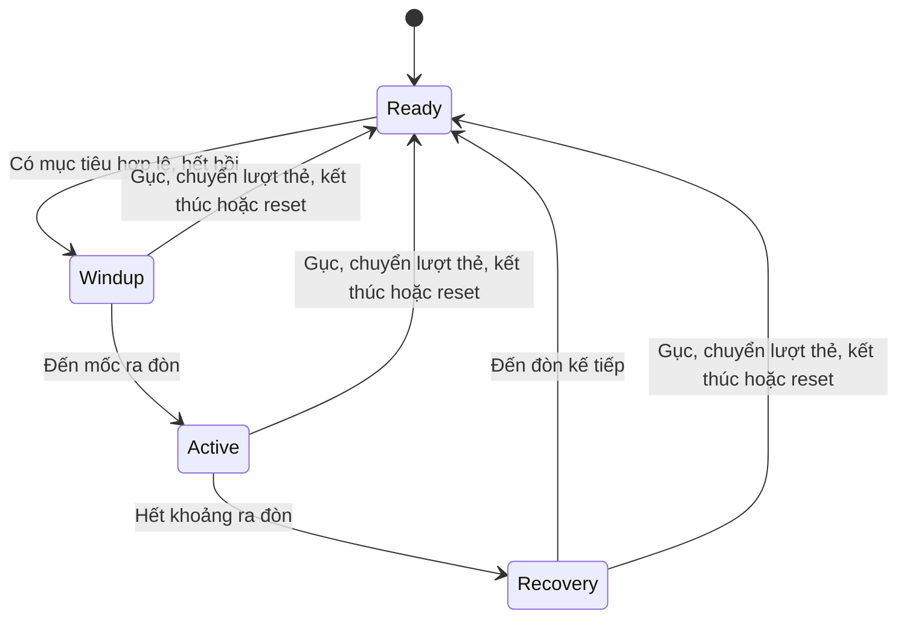

# Tham khảo Brotato: tấn công và cảm giác chiến đấu của LẠC

Ngày nghiên cứu: **11/10/2026**. Phạm vi **Kiệt**: Combat/Player/VFX/Core và đồng bộ trong ván. Đây là nghiên cứu và phương án triển khai T-50B/T-50/T-51; chưa đổi mã, chỉ số nhân vật hoặc nghiệm thu feel trong Play Mode.

## 1. Nguồn và độ chắc chắn

[Trang Brotato chính thức trên Steam](https://store.steampowered.com/app/1942280/Brotato/?l=english) xác nhận mặc định tự bắn, có tùy chọn ngắm thủ công, mang tối đa sáu vũ khí, wave tính giờ 20–90 giây và nhặt nguyên liệu để nâng cấp/mua giữa wave. Những nội dung này là thông tin nhà phát hành, không phải đánh giá cảm giác chơi của người nghiên cứu.

[Phân tích gốc của mojimoon về cooldown](https://github.com/mojimoon/brotato/blob/main/docs/Brotato-weapon-cooldown-en.md) phân biệt đòn cận chiến quét/đâm, mô tả chu kỳ chuẩn bị–ra đòn–thu hồi, và quan hệ giữa hoạt ảnh, attack speed và range. Đây là nghiên cứu độc lập của tác giả, không phải tài liệu chính thức của nhà phát triển. Chỉ tham khảo cấu trúc chu kỳ, không nhập công thức/giá trị frame của bài vào LẠC hoặc coi chúng là đúng với mọi bản Brotato.

Phần “feel” và các thời gian thử nghiệm dưới đây là **phân tích/đề xuất riêng cho LẠC**, dựa trên những cơ chế này và mã dự án. Chưa trực tiếp chơi bản Brotato hiện hành, chưa đo input latency/hit-stop của nó; không khẳng định Brotato dùng đúng các thông số được đề xuất. Không dùng bình luận diễn đàn hoặc bản mobile làm bằng chứng cho mã PC.

## 2. Cảm giác nên học từ vòng lặp này

Tự đánh chuyển quyết định của người chơi sang **vị trí**: tiến đến đúng tầm, đi vòng để thoát vây, giữ khoảng cách với kẻ lao tới. Khi đủ gần, vũ khí phải ra đòn dễ đoán; người chơi thấy được mình vừa tạo ra khoảng trống và có thể đi nhặt phần thưởng.

Vòng phản hồi mong muốn của LẠC:

```text
Chọn vị trí → vũ khí tự ngắm/ra đòn → thấy đòn chạm
→ quái phản ứng/chết → Hồn bay về/nạp trống → tiếp tục di chuyển
→ hết wave → chọn thẻ → thấy nhịp/tác dụng của nâng cấp ngay wave sau
```

Đây là kết luận thiết kế từ vòng lặp tự đánh và wave tính giờ, không phải khẳng định một quy trình nội bộ của Brotato. Với LẠC, Hồn/Trống Đồng và Chằn Tinh là nội dung chính để gắn vòng phản hồi đó với đồ án hiện có.

## 3. Nền tảng LẠC đã có

| Thành phần | Mã/asset hiện hành | Trạng thái |
|---|---|---|
| Tự đánh khi có mục tiêu trong tầm | `Combat/WeaponAuto.cs`, `Enemies/EnemyRegistry.cs` | Nearest được tìm mỗi Update, chỉ khai hỏa khi hết cooldown và có mục tiêu |
| Kiếm quét nhiều quái | `WeaponAuto.FireArc` | Cung 110°, tầm 2,2; sát thương tức thời trong vùng |
| Thương đâm xuyên hàng | `WeaponAuto.FireThrust` | Dải rộng 0,8, dài 3,2; sát thương tức thời trong vùng |
| Tên bay rồi mới gây sát thương | `WeaponAuto.FireLine`, `Combat/Projectile.cs` | Tầm 8, tốc độ 16; quét đoạn đường, xử lý va chạm theo thứ tự chạm |
| Di chuyển khi đang đánh | `Player/PlayerMovement.cs`, `PlayerAnimatorDriver.cs` | Hoạt ảnh one-shot không tự khóa vận tốc di chuyển |
| Nâng cấp nhịp/tầm/sát thương | API đã có của `Cards/PlayerUpgradeState.cs` | Combat đọc chỉ số runtime, không sửa CharacterData asset |
| Phản hồi trúng đòn | `VFX/HitFeedback.cs`, `SpriteFlash.cs`, `DamageNumber.cs` | Nháy, knockback, số sát thương, rung/hit-stop theo mức độ |
| Phần thưởng hút về | `Core/SoulPickup.cs`, `Audio/PitchLadder.cs` | Hồn hút về và nạp trống, đã có cơ chế âm nhặt |
| Nhịp ván | T-44D, 9 wave tính giờ và boss wave 10 | Giữ 9 lượt thẻ, boss/Restart; không cần mở rộng số wave |

Không coi việc giảm cooldown hoặc tăng số VFX là đủ để đạt cùng cảm giác. Bộ ba LẠC có một vũ khí cố định mỗi lớp; số lần tác động lên quái và mức dễ đọc cần cân bằng theo hệ thống đó.

## 4. Những chỗ đáng sửa trong mã hiện tại

### 4.1 Thời điểm đánh và động tác chưa có cùng một mốc

`WeaponAuto.Fire` gọi FireArc/FireThrust gây sát thương, hoặc FireLine sinh tên, **rồi mới** phát `Fired` để `PlayerAnimatorDriver` bắt đầu hoạt ảnh. `ArcSlash`/`SpearThrust` hiện vùng đánh ngay và mờ dần; chưa có khoảng đòn đang tiến ra làm vùng sát thương hoạt động.

Kết luận chắc chắn từ mã là thứ tự thực thi đó. Cần xem clip Play Mode để xác định mức lệch người chơi thực sự thấy. Đề xuất cho T-50B: có mốc bắt đầu đòn, mốc chạm/nhả tên và mốc kết thúc; host gây sát thương ở mốc gameplay, biểu diễn khớp mốc ấy.

Đã xem ảnh sprite nguồn `Warrior_Attack1.png` và `Archer_Shoot.png`: kiếm có hai frame chuẩn bị trước frame vung, cung có các frame nạp/kéo trước frame thả. Asset đang chạy có Warrior 4 frame/18fps, Archer 8 frame/18fps, Lancer 3 frame/18fps. Việc sinh tên/gây damage trước khi bắt đầu những clip này là điểm cần đối chiếu bằng video runtime; ảnh sprite nguồn không thay clip nghiệm thu gameplay.

### 4.2 Hoạt ảnh chưa dùng chu kỳ đã nâng cấp

WeaponAuto dùng `PlayerUpgradeState.AttackIntervalFromBase` để giảm chu kỳ sau thẻ. Nhưng `PlayerAnimatorDriver.OnFired` tính budget bằng **`data.AttackInterval × _attackClipBudget`**, chưa lấy chu kỳ runtime. `SpriteAnimator.PlayOneShot` bắt đầu lại từ frame đầu mỗi đòn mới.

Rủi ro: khi chu kỳ runtime ngắn hơn clip đang chạy, hoạt ảnh bị cắt ở đòn tiếp theo; nâng cấp đánh nhanh nhưng động tác không theo kịp. Phải kiểm tra từng bộ TinySwords, vì clip ngắn của Warrior có thể ít bị ảnh hưởng hơn clip của lớp khác.

**Giới hạn của phát hiện:** ba Liên Kích hiện cho 1,45× tốc đánh. Khi đó chu kỳ Warrior/Archer/Lancer lần lượt khoảng 0,448/0,483/0,586s, vẫn dài hơn clip 0,222/0,444/0,167s. Vì vậy chưa kết luận bộ thẻ hiện có đã làm kẹt hoạt ảnh; việc lấy đúng chu kỳ runtime là sửa sự nhất quán và bảo vệ các tinh chỉnh sau này, không lấy rủi ro tương lai làm lỗi đã xảy ra.

Đề xuất: WeaponAuto cung cấp chu kỳ đang dùng; animator đọc cùng giá trị để fit động tác vào mỗi đòn. Kiệt tái sử dụng API Cards hiện có, không sửa hệ thống thẻ thuộc Hung.

### 4.3 Hướng ngắm có thể hết hạn trước khi động tác kết thúc

Animator gọi `FaceTowards(direction, _aimHold)` với mặc định **0,25s**. Khi hạn này hết, `PlayerMovement.ApplyFlip` quay lại hướng di chuyển. Nếu động tác đánh còn chạy, thân/vũ khí có thể đổi hướng giữa động tác.

Prefab Player hiện cũng tuần tự hóa `_aimHold: 0.25` và `_attackClipBudget: 0.8`. Clip Archer dài khoảng 0,444s ở nhịp gốc, nên có khoảng thời gian động tác chưa kết thúc nhưng quyền giữ hướng đã hết; cần thử tình huống đi ngược hướng ngắm để đánh giá.

Đề xuất: chốt hướng tại đầu đòn, giữ qua phần ra đòn/thu hồi cần thiết, chọn lại cho đòn sau. Không khóa WASD hoặc dash vì đang đánh. Điều kiện này là thiết kế riêng cho LẠC, chưa xác nhận Brotato dùng cơ chế giữ mục tiêu giống vậy.

### 4.4 Hit-stop cần phù hợp online

`HitFeedback` yêu cầu HitStop khi quái chết và người chơi trúng đòn. `HitStop.Request` đặt **Time.timeScale = 0** tối đa 30ms; các yêu cầu chồng lấy hạn xa nhất, không cộng thời gian trực tiếp. Dù tạo sức nặng, nó tác động toàn mô phỏng tại máy đó; wave dùng NetworkTime có thể tiếp tục trong lúc gameplay đang khựng.

Đề xuất: ưu tiên nháy/quán tính hình ảnh/rung nhẹ hoặc dừng riêng hoạt ảnh để giữ cảm giác chạm, hạn chế nhịp feedback khi dọn nhiều quái. Một luồng cho host một/hai người, không thêm `if (isSinglePlayer)`. Không lấy 20–30ms hiện tại làm “thông số chuẩn Brotato”.

## 5. Cách áp dụng cho từng lớp

| Lớp | Cảm giác mục tiêu | Động tác và vùng đánh | Ưu tiên phản hồi |
|---|---|---|---|
| **Warrior** | Quét rộng, mở một khe trong đám đông | Chuẩn bị ngắn → vung cung rõ → thu kiếm; mỗi quái tối đa một hit trong mỗi đòn | Nháy/đẩy lùi dễ thấy, vệt chém ngắn theo đúng cung; không cần rung mạnh cho từng quái |
| **Lancer** | Đâm chắc, thưởng cho đứng thẳng hàng | Thu thương → đâm ra nhanh → rút về; vùng đâm theo trục, mỗi quái tối đa một hit/đòn | Tín hiệu lực đâm ngắn, đường đâm rõ; đánh nhiều quái trên hàng vẫn cùng một đòn |
| **Archer** | Bắn gọn, giữ khoảng cách, tên chạm rõ | Chuẩn bị/nhả tên ở một mốc → tên bay → sát thương tại va chạm → hồi động tác | Phân biệt nhả tên và tên trúng; phát sau dash vẫn nhân sát thương đúng một lần |

TinySwords đã vẽ vũ khí chung trong sprite thân, trong khi cách biểu diễn vũ khí rời là một lựa chọn khác. Không xoay nguyên sprite người 360° chỉ để bắt chước vũ khí rời. Kiểm tra frame hướng đang có; dùng flip/clip phù hợp và VFX mô tả hướng thật, chỉ tách vũ khí nếu cần một hạng mục mỹ thuật riêng.

### Khoảng thời gian để thử, chưa phải chỉ số đã chốt

Mốc chuẩn bị có thể thử **40–80ms**, phần vung/đâm rõ **100–160ms**, nhưng phải căn frame và FPS của từng bộ sprite. Không dùng những con số này như phép đo Brotato. Tổng thời gian đòn phải nằm trong chu kỳ runtime; không cộng wind-up thêm lên cooldown gốc khiến DPS giảm ngoài ý muốn.

Trước tiên giữ damage/interval/range đang có để so sánh hai phiên bản feel. Sau khi chọn cách ra đòn, T-50 mới chốt sát thương và T-51 chốt đường cong wave. Chỉ số của bản nghiên cứu này không tự ghi vào asset.

## 6. Chu kỳ đòn gọn và dễ giải thích



Đây là đề xuất **chưa được cài**. Với tên, Active là nhả đạn; đạn có vòng đời riêng và gây sát thương khi chạm. Với kiếm/thương, Active là cửa sổ đánh của đòn đó. Không buộc nhiều va chạm vật lý mỗi frame nếu một mốc contact đủ đạt cảm giác mong muốn; chọn bản đơn giản nhất qua chơi thử.

Điểm cần chốt khi lập trình:

- Hướng và chỉ số hiệu lực được chốt cho đòn đang ra; nâng cấp chỉ áp vào đòn mới.
- Host kiểm tra các quái đang sống tại contact; không gây sát thương lên mục tiêu đã chết hoặc object được pool tái sử dụng sau wind-up.
- Nếu quái đầu tiên đã chết, đòn vẫn kết thúc theo hướng đã chọn, không quay giật sang quái khác ở giữa động tác. Các quái hợp lệ khác trong vùng vẫn có thể trúng.
- Một đòn không đánh cùng quái nhiều lần chỉ vì cửa sổ Active kéo dài qua nhiều frame.
- Gục/chọn thẻ/kết thúc ván/Restart hủy phần chưa thi hành và reset sequence/hit cache.
- Shot sau dash chỉ tiêu bonus một lần tại mốc đã quy định; số tên/xuyên/nổ vẫn dùng hiệu ứng thẻ hiện có.

## 7. Multiplayer: người chơi phải đọc cùng một đòn

Hiện WeaponAuto chạy cục bộ cho mọi player trên mọi máy; DamageSystem chỉ có hiệu lực host. Cách đó giữ băng thông thấp, nhưng mục tiêu/hướng/timing biểu diễn có thể khác do snapshot và cooldown cục bộ.

Khi T-50B có wind-up/contact, cần kiểm tra độ lệch này. Nếu không đủ chính xác, host phát **sự kiện bắt đầu đòn** qua player đã có NetworkIdentity: sequence, hướng, kiểu đòn, mốc NetworkTime và thông số biểu diễn cần thiết. Client bắt kịp timeline và bỏ sự kiện cũ/trùng; không biến đạn hoặc VFX thành network object.

Đây là phương án mạng đề xuất, chưa có `PlayerAttackNetwork` trong dự án. Chỉ thêm khi kiểm thử cho thấy cần thiết, giữ solo là cùng host flow và không tạo giao thức phòng mới. Kiệt sở hữu phần đồng bộ trong ván; T-30/T-62/T-40/T-42 của Kang không nằm trong thay đổi này.

Phản hồi trúng đòn phải theo kết quả host: chỉ phát nháy/số sát thương thật khi có xác nhận. Cần kiểm tra điểm nối GameEvents/RPC hiện có trước thêm relay, tránh phát feedback hai lần trên host.

## 8. Đo feel và cân bằng thế nào?

Không chỉ nhìn damage/cooldown. Ghi cả thời gian hạ mục tiêu (TTK), số đòn hụt, số quái trúng một lần, khoảng thời gian có mục tiêu trong tầm và số lần phải thoát vây.

Ví dụ DPS lý thuyết hiện tại, chưa tính đánh nhiều mục tiêu, hụt, thẻ hoặc bonus dash:

| Lớp | Damage/chu kỳ | DPS một mục tiêu lý thuyết |
|---|---|---:|
| Warrior | 4/0,65s | 6,15 |
| Archer | 4/0,7s | 5,71 |
| Lancer | 5/0,85s | 5,88 |

Các giá trị gần nhau không chứng minh ba lớp cân bằng: Warrior quét rộng, Lancer xuyên hàng, Archer có tầm xa/tên bay và bonus dash. Cần chơi cùng seed/baseline, cùng mức thẻ và cùng số người; so sánh trước/sau với AI Cố định trước để Chằn Tinh không che mất thay đổi của vũ khí, sau đó thử Thích ứng.

Tình huống nghiệm thu T-50B:

1. Một quái trước mặt/ở cạnh/ở mép tầm: nhìn đúng hướng và thời điểm contact, không trúng ngoài vùng đã thiết kế.
2. Ba quái trên một hàng và ba quái trong cung: thương/kiếm thể hiện đúng ưu thế, tối đa một hit/quái/đòn.
3. Đi sang trái nhưng đánh bên phải: di chuyển vẫn đáp ứng, thân/vũ khí không đổi hướng giữa phần ra đòn.
4. Tăng attack speed bằng thẻ đã có đến giới hạn: hoạt ảnh theo chu kỳ runtime, không kẹt frame đầu hoặc tạo DPS không khớp chỉ số.
5. Mục tiêu chết trong wind-up, player gục hoặc chuyển lượt thẻ: không rò sát thương cũ; Restart reset sạch.
6. Hai Editor/100ms rồi hai máy thật: hướng/mốc contact đọc nhất quán, host quyết damage, feedback không đếm đôi, tên/VFX không có NetworkIdentity.
7. 40 quái/200 đạn: Console không lỗi đỏ, chụp Game View và đo lại frame time; không dùng benchmark cũ thay bằng chứng sau sửa combat.
8. Chơi trọn ván tự nhiên cả ba lớp và các cặp co-op; ghi nhận độ rõ, cảm giác lực và khả năng giữ khoảng trống. Fixture không chứng minh “vui như Brotato”.

## 9. Thứ tự triển khai của Kiệt

1. **T-50B:** chia mốc ra đòn, đồng bộ ngân sách hoạt ảnh với tốc độ thật, giữ hướng trong đòn và xử lý feedback/co-op. Chốt cảm giác bằng clip và thử hai Editor.
2. **T-50:** cân bằng damage sau khi timing/hitbox ổn; dùng TTK và hiệu quả nhóm mục tiêu, không chỉ DPS bảng.
3. **T-51:** điều chỉnh nhịp/thành phần của 10 wave cho cả solo và co-op, giữ ý đồ Chằn Tinh và các giới hạn an toàn.
4. **T-53:** chơi thật, thu dữ liệu/ý kiến và kiểm thử online với nhóm; sau đó T-54 tổng hợp đánh giá.

Phương án này giữ ba lớp/vũ khí cố định, 12 thẻ, Hồn/Trống Đồng, 10 wave và Chằn Tinh. Shop, sáu ô vũ khí hoặc sao chép toàn bộ công thức Brotato không là điều kiện để hoàn thiện cảm giác chiến đấu cho đồ án.
